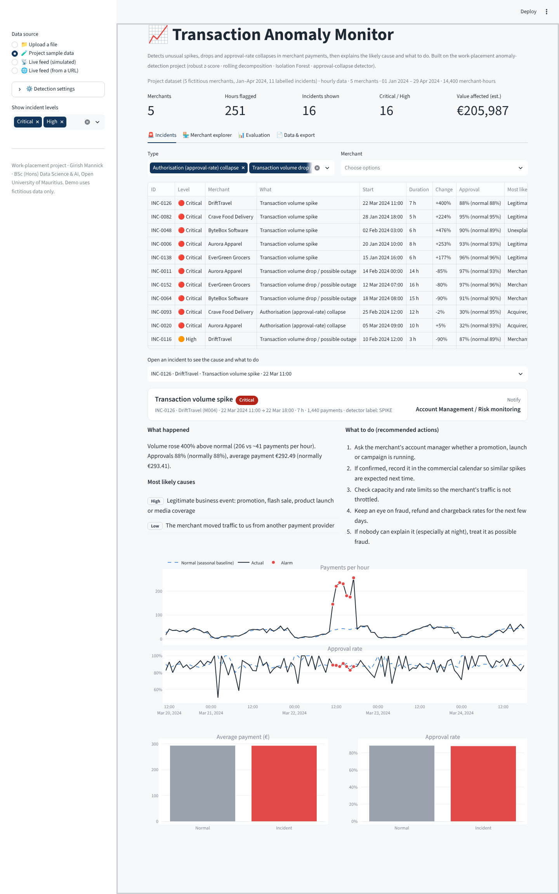

# 📈 Transaction Anomaly Monitor

A website that watches merchant payment data and **automatically raises an alarm** when something unusual happens: a sudden **spike**, a **drop / outage**, or a **collapse in the approval rate**. For every alarm it explains **what happened**, the **most likely cause** and **what to do**.

It is built on my work-placement project (BSc (Hons) Data Science & AI, Open University of Mauritius). The detection rules are the **same code as the project notebook** (`engine/anomaly_detection.py`), so the website gives the same results:

| Check on the project dataset | Notebook | Website |
|---|---|---|
| Incidents detected | 11 / 11 | 11 / 11 |
| Recall (anomalous hours caught) | 0.87 | 0.874 |
| Precision | 0.386 | 0.386 |
| Spike / Drop / Approval-collapse recall | 100% each | 100% each |



> Demo data is fictitious. Never upload real company or customer data to a public website.

---

## What you can do on the website

| Data source (left sidebar) | What happens |
|---|---|
| **📁 Upload a file** | CSV, Excel, JSON or Parquet. Either hourly data (like the project) **or one row per payment**: it is grouped into hours automatically. Column names are recognised automatically (`timestamp`, `Created_At`, `merchant`, `amount`, `status`, `scheme`, `response_code`…). |
| **🧪 Project sample data** | The project's dataset (5 merchants, Jan–Apr 2024, 11 labelled incidents). The **Evaluation** tab reproduces the notebook tables. |
| **📡 Live feed (simulated)** | Payments arrive hour by hour. Press **💥 Inject** to create an outage, approval collapse, card-testing attack or flash sale, then **⏭ +1 hour** / **▶️ Play** and watch it get detected and explained. |
| **🌐 Live feed (from a URL)** | Paste the link of any CSV/JSON that is kept up to date (e.g. a Google Sheet "Published to the web" as CSV, or a company API). The site re-checks it automatically. Optional Slack/Teams alerts. |

For every incident: level (Critical / High / Medium / Low), plain-English summary, likely causes ranked by confidence, numbered action plan, team to notify, estimated value affected, and charts (actual vs normal, approval rate, average payment, card network and decline reasons when available). Everything can be downloaded as CSV.

---

## How it works (short version)

```
your data ──► adapter.py ──► anomaly_detection.py (project code) ──► explain.py ──► website
             (reads any       4 detectors + 2-of-3 vote:              (groups alarms into
              file, makes      • robust seasonal z-score               incidents, finds the
              hourly table)    • rolling seasonal decomposition        likely cause, adds the
                               • Isolation Forest                      action plan)
                               • approval-rate collapse detector
```

1. **Learn normal**: for every merchant, weekday and hour, the usual number of payments and approval rate.
2. **Compare** every hour with normal using the four detectors.
3. **Vote**: an alarm needs 2 of the 3 volume detectors to agree, or the approval-rate detector on its own.
4. **Explain**: consecutive alarm hours become one incident; the evidence (direction, size, time of day, payment size, approvals, card network, decline codes, other merchants affected) decides the likely cause and the playbook.

---

## Files in this repository

```
app.py                      the website (Streamlit)
engine/
  anomaly_detection.py      project detector (unchanged from the notebook)
  generate_data.py          project data generator (unchanged)
  evaluation.py             project evaluation metrics (unchanged)
  adapter.py                reads any upload / live feed into the detector's format
  explain.py                incidents, likely causes and recommended actions
  live.py                   simulated live feed + incident injection
  pipeline.py               adapter → detector → explanations in one call
monitor.py                  command-line version (used by GitHub Actions)
tests/test_engine.py        automatic checks (run on GitHub on every change)
.github/workflows/          GitHub Actions: tests + scheduled monitor
sample_data/                project dataset + an example "one row per payment" file
notebooks/                  original project notebook
docs/                       screenshots
requirements.txt            Python libraries the website needs
.streamlit/config.toml      website colours and settings
Dockerfile                  optional: run anywhere with Docker
```

---

## Step-by-step: put it online with GitHub (free, about 20 minutes)

### 1. Create a GitHub account
Go to **github.com → Sign up**. Choose your username carefully (it appears in your links), e.g. `girishmannick`.

### 2. Create the repository
**+** (top right) → **New repository** → name `transaction-anomaly-monitor` → **Public** → tick **Add a README file** → **Create repository**.

### 3. Upload the files
1. Unzip the project zip on your computer and **open** the `transaction-anomaly-monitor` folder.
2. On GitHub: **Add file → Upload files**.
3. Select **everything inside** the folder (not the folder itself) and drag it onto the page. Use Chrome or Edge so sub-folders are kept.
4. Click **Commit changes**.
5. Check that `app.py` and `requirements.txt` are at the **top level** and that `engine`, `sample_data`, `tests` folders exist.

> **Hidden folders** (`.github` and `.streamlit`) start with a dot and may be invisible on Mac (press **Cmd + Shift + .** to show them). If they did not upload, create them on GitHub: **Add file → Create new file**, type the name `.github/workflows/tests.yml` (the `/` creates folders), paste the file's contents, **Commit**. Repeat for `.github/workflows/monitor.yml` and `.streamlit/config.toml`. The website works without them; they add automation and colours.

### 4. Publish the website (Streamlit Community Cloud)
1. Go to **share.streamlit.io** → **Continue with GitHub** → allow access.
2. **Create app** → **Deploy a public app from GitHub**.
3. Repository `your-username/transaction-anomaly-monitor`, branch `main`, main file `app.py`.
4. **App URL**: type e.g. `girish-mannick-anomaly` → your site becomes `https://girish-mannick-anomaly.streamlit.app`.
5. **Advanced settings** → Python **3.11** → Save → **Deploy**. Wait 3–5 minutes.

### 5. Check the GitHub automation
Open the **Actions** tab of your repository:
* **Tests** runs automatically after every change and shows a ✅ when everything still works.
* **Anomaly monitor** → **Run workflow** analyses the sample data (or any file/URL you type) and shows the incident report on the run's summary page; the full report is downloadable under *Artifacts*.
* For **hourly monitoring of a live feed** with no website open: **Settings → Secrets and variables → Actions → New repository secret**, name `FEED_URL`, value = your CSV/JSON link. GitHub then checks it every hour and opens an **Issue** (with email notification) whenever a Critical/High incident appears.

### 6. Making changes later
Open any file on GitHub → ✏️ → edit → **Commit changes**. The website updates itself within a minute and the tests re-run.

---

## Run it on your own computer (optional)

```bash
python -m venv .venv
# Windows: .venv\Scripts\activate     Mac/Linux: source .venv/bin/activate
pip install -r requirements.txt
streamlit run app.py          # opens http://localhost:8501
pytest -q                     # run the automatic checks
python monitor.py --source sample_data/synthetic_transactions.csv
```

## Data format

**Hourly** (like the project): `timestamp, merchant_id, txn_count` (required) + `auth_count` or `declined`, `total_value`, `merchant_name` (recommended) + `is_anomaly, anomaly_type` (optional, turns on the Evaluation tab) + `visa_txns, visa_auth, …` and decline-code counts `d05_…, d91_…` (optional, better diagnosis).

**One row per payment**: `timestamp, merchant_id, amount, status` + optional `scheme, response_code`.

Use at least 3–4 weeks of history so the detector can learn what "normal" looks like.

## Settings
**⚙️ Detection settings** in the sidebar: alert threshold (lower = more sensitive; project default 4.0), how many detectors must agree (default 2), approval-collapse threshold (default 3.5).

## Path to production (company use)
In a real payment company the website would run inside the company network, read the hourly aggregates from the data warehouse or a stream (Kafka/Kinesis), and send alerts into Slack/PagerDuty/case management. The `engine/` package has no website code in it, so it can be reused unchanged inside an API or a scheduled job.
